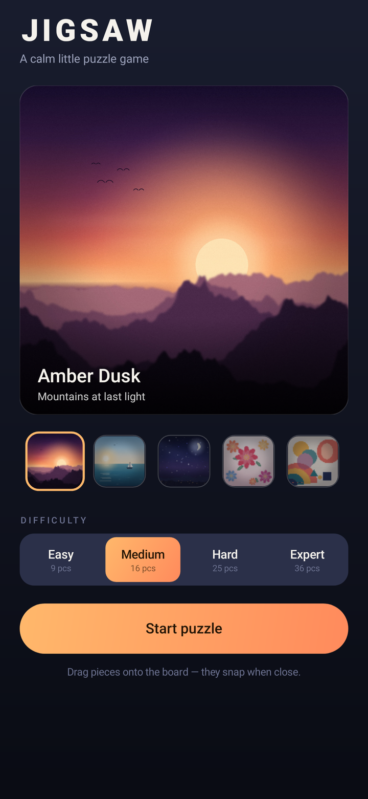
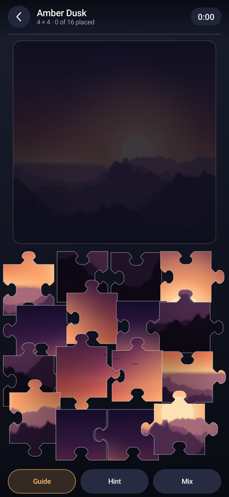

# Jigsaw

A calm, fully offline jigsaw puzzle game for Android. Pieces are real interlocking
shapes, they follow your finger, and they click into place with a soft snap and a
little haptic tick. Solve the picture and it is revealed under a shower of confetti.

Built with Kotlin and the Android framework's `View` system, drawing pieces on a
`Canvas` — no Compose, no AndroidX and no third-party libraries in the app itself
(AndroidX only appears as a test-only dependency of Robolectric). Fully offline.




## Install

```
app-debug.apk            <- prebuilt, ready to install
```

Copy the APK to your phone and open it (you may need to allow "install unknown
apps" for your file manager), or install over USB:

```powershell
& "<path to Android SDK>\platform-tools\adb.exe" install -r app-debug.apk
```

Minimum Android 7.0 (API 24), tested against API 34.

## Playing

- **Drag** a piece from the tray onto the board. Drop it near the right cell and it
  snaps, locks and ticks.
- **Guide** shows a faint preview of the finished picture on the board. Toggle it off
  for a harder game.
- **Hint** pulses the outline of the piece you should place next, both where it
  belongs and where it currently sits.
- **Mix** re-scatters the loose pieces when the tray gets messy.
- The timer starts on your first grab. When the last piece lands you get the full
  picture plus your time, piece count and grid.

## Difficulty

| Level  | Grid  | Pieces |
| ------ | ----- | ------ |
| Easy   | 3 × 3 | 9      |
| Medium | 4 × 4 | 16     |
| Hard   | 5 × 5 | 25     |
| Expert | 6 × 6 | 36     |

Five built-in artworks are generated procedurally (no licensed images): Amber Dusk,
Still Water, Midnight, Paper Bloom and Bauhaus.

## Opening in Android Studio

1. **File ▸ Open** and pick the folder that contains `settings.gradle.kts`.
2. Trust the project, then let Gradle sync (it downloads Gradle 8.7 through the
   wrapper on the first run).
3. **Settings ▸ Build, Execution, Deployment ▸ Build Tools ▸ Gradle ▸ Gradle JDK** →
   any JDK 17.
4. Pick an emulator or a USB device and press **Run ▶**.

`local.properties` is generated by Android Studio on the first sync and is deliberately
not shipped — it holds a machine-specific SDK path.

## Building from the command line

Requirements: JDK 17, Android SDK with `platforms;android-34` and `build-tools;34.0.0`.

```powershell
$env:JAVA_HOME  = '<path to jdk-17>'
$env:ANDROID_HOME = '<path to Android SDK>'
.\gradlew.bat assembleDebug
```

The wrapper pins Gradle 8.7, so no global Gradle install is needed. If you prefer to
build without Studio, create `local.properties` containing `sdk.dir=<your sdk path>`
(escaping backslashes) or rely on `ANDROID_HOME`.

Output: `app/build/outputs/apk/debug/app-debug.apk`

## How the pieces work

`Puzzle.kt` builds the board as a graph of shared edges. Every internal boundary is
one polyline; the two neighbouring pieces walk it in opposite directions, so their
outlines are exact complements and there are never gaps or overlaps. Tabs are a
Catmull-Rom spline through a seven-point half-profile (narrow neck, round head),
mirrored around the edge midpoint.

Piece positions are stored in *unit board space* (`0..1` over the board), so a
rotation or resize only rebuilds the outlines — never the game state.

Touch picking uses a per-piece `Region` built from the real outline, not the bounding
box, so notches and tabs behave the way they look.

## Tests

`app/src/test/.../ScreenshotTest.kt` runs the real `Activity`s under Robolectric with
native graphics. It launches both screens, drags every piece of a puzzle into place
with synthetic `MotionEvent`s, checks the win state, taps *Play again*, and writes
PNGs to `app/build/reports/screenshots/`.

```powershell
.\gradlew.bat testDebugUnitTest
```

## Layout

```
app/src/main/java/com/lalit/jigsaw/
  MainActivity.kt   menu: artwork picker, difficulty, start
  GameActivity.kt   HUD, timer, progress, result card
  PuzzleView.kt     board, tray, drag/snap, hint, confetti
  Puzzle.kt         Difficulty, Piece, BoardGeometry (the cut geometry)
  Widgets.kt        ArtPreview, ArtPicker, Segmented, PillButton, CircleButton, ProgressLine
  Art.kt            artwork list + small bitmap cache
  Sound.kt          SoundPool wrapper for the two cues
  Theme.kt          palette, type, dp/sp helpers
tools/              Python generators for the artwork, icons, sounds and geometry prototype
```
